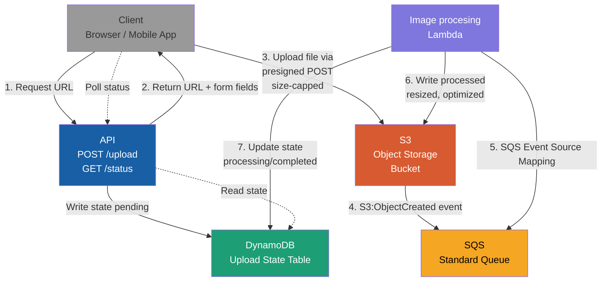
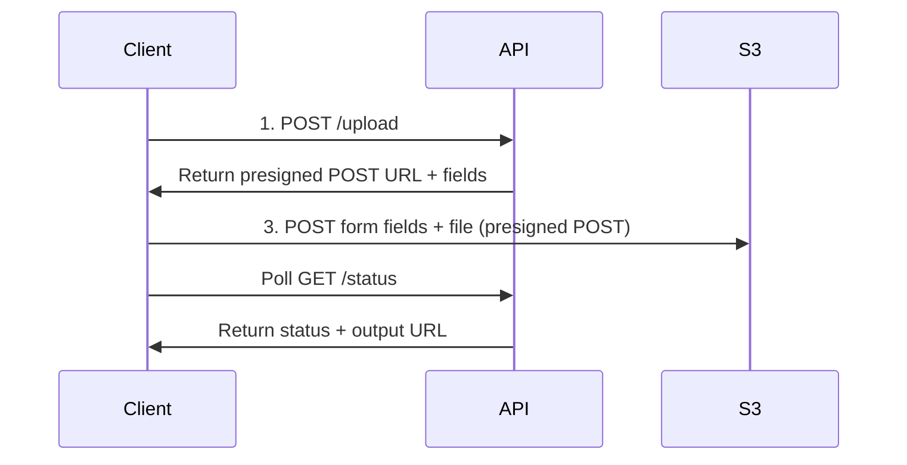

# Image Processor - Design

## Table of Contents

<!--TOC-->

- [Objective](#objective)
- [Non-goals](#non-goals)
- [Architecture — Tech Stack](#architecture--tech-stack)
- [Code Layout](#code-layout)
- [Architecture Diagram](#architecture-diagram)
- [API Definition](#api-definition)
- [Upload Constraints](#upload-constraints)
- [User Flow](#user-flow)
- [Worker Flow](#worker-flow)
- [Error Handling & Retry Strategy](#error-handling--retry-strategy)
- [Persistence & State Transitions](#persistence--state-transitions)
- [S3 Key Convention](#s3-key-convention)
- [Image Resizing Strategy](#image-resizing-strategy)
  - [Edge cases](#edge-cases)
- [Serving processed images](#serving-processed-images)
- [Non-Functional Requirements](#non-functional-requirements)

<!--TOC-->

## Objective

Build a service for uploading and serving optimized images for web applications handling resizing and format conversion automatically.

## Non-goals

Support for anything other than images. This is not a media processor.

## Architecture — Tech Stack

- CDK
- Github Actions
- Python 3.14, uv
- API Gateway HTTP API
- AWS Lambda Powertools, Pydantic, Pillow

## Code Layout

Each Lambda is its own uv workspace member, so each ships only its own
dependencies (Pillow never lands in the API's bundle):

| Member | Purpose | Dependencies |
|---|---|---|
| `handlers/api` | One Lambda behind the HTTP API. A Powertools `APIGatewayHttpResolver` with a `Router` per area (`uploads`, `status`), combined via `include_router`. `enable_validation=True` validates requests and serializes responses from Pydantic models | Powertools, Pydantic, `common` |
| `handlers/processor` | SQS consumer that resizes images, using Powertools' `BatchProcessor` | Powertools, Pillow, `common` |
| `handlers/common` | Shared library, not a Lambda: the Pydantic model for the DDB status record, the status enum, and the conditional status update | Pydantic |

The status record is written by the API (`pending`) and updated by the
processor (`processing`, `complete`, `failed`). Its model and the rule that
status never moves backwards live in `common`, so the two Lambdas can't drift.

## Architecture Diagram



## API Definition

`POST upload`

Response:

```json
{
    "image_id": "server side generated guid",
    "upload": {
        "url": "https://<bucket>.s3.<region>.amazonaws.com/",
        "fields": {
            "key": "uploads/<image_id>",
            "Content-Type": "image/jpeg",
            "policy": "<base64 policy>",
            "x-amz-algorithm": "AWS4-HMAC-SHA256",
            "x-amz-credential": "...",
            "x-amz-date": "...",
            "x-amz-security-token": "...",
            "x-amz-signature": "..."
        }
    }
}
```

The client uploads with a `multipart/form-data` POST to `upload.url`, sending
every entry in `upload.fields` followed by the file as the last field, `file`.

`GET status/{guid}`

Response:

```json
{
    "status": "pending|processing|complete|failed",
    "images": {
        "thumb": "https://thumbnail-uri",
        "full": "https://full-uri"
    }
}
```

## Upload Constraints

Uploads use an S3 **presigned POST**, not a presigned PUT. A presigned PUT URL
can't limit the upload size; a presigned POST carries a signed policy that S3
enforces, rejecting non-conforming uploads before they're stored.

Policy conditions set by the API:

- `content-length-range`: 1 byte up to the upload limit (proposed **20 MB**, to
  confirm)
- `key`: exactly `uploads/{image_id}`
- `Content-Type`: starts with `image/`. Client-declared, so the processor still
  verifies the real format
- Expiry: short-lived (5–15 minutes)

Consequences:

- **Event routing:** S3 reports these uploads with event reason `PostObject`.
  The EventBridge rule must match `PostObject` (and `PutObject`, so console
  uploads still work for testing), or uploads are silently ignored.
- **CORS:** browsers upload directly to S3, so the bucket needs a CORS rule
  allowing `POST` from the client's origin.
- **IAM:** the API Lambda signs the policy with its own credentials, so its role
  needs `s3:PutObject` on `uploads/*` only.

## User Flow

- Request an upload (presigned POST URL + form fields)
- Poll a status endpoint
- On complete response will include urls for thumb and large image



## Worker Flow

- S3 Object Created events (`PostObject`) routed via EventBridge to an SQS queue
- Lambda event source for the queue
- Loads and resizes images

## Error Handling & Retry Strategy

SQS only redelivers a message when the Lambda reports it as failed. A message
the handler returns successfully for is deleted, even if the image itself
failed. So the processor splits errors in two:

| Error | Examples | Handling | Outcome |
|---|---|---|---|
| **Permanent** | Unsupported format, corrupt file, too large | Set status to `failed` in DDB, return success | Message deleted; client sees `failed` when polling |
| **Transient** | Throttling, timeouts, S3/DDB errors | Report as a batch item failure | Redelivered after the visibility timeout |

- **Partial batch failures:** the SQS event source uses
  `report_batch_item_failures`, with Powertools' `BatchProcessor`, so only the
  failed messages in a batch are retried, not the whole batch.
- **Dead-letter queue:** after 3 receives (`maxReceiveCount`), a message moves to
  the DLQ, which keeps messages for 14 days for investigation and redrive. A
  message in the DLQ therefore means a transient error that never cleared.
  Permanent errors never reach it.
- **Visibility timeout:** at least 6× the processor Lambda's timeout (AWS
  guidance for SQS event sources), so a message isn't redelivered while still
  being processed.
- **Idempotency:** standard SQS delivers at least once, so the processor must
  tolerate duplicates. Outputs go to deterministic keys
  (`processed/{guid}/...`), so reprocessing overwrites them, and status updates
  must not move a record backwards (e.g. `complete` → `processing`).

## Persistence & State Transitions

- User requests an upload URL
- Record written to DDB recording the generated guid and pending status
- Processor lambda gets S3 put events via SQS, it sets processing
- When done, it sets complete
- Update logic needs to support going right from pending to complete even if that won't happen in this implementation
- Status never moves backwards. Updates are conditional writes, implemented
  once in the `common` member and used by both Lambdas
- TTL on records

## S3 Key Convention

`uploads/{guid}` - original image
`processed/{guid}/thumb.webp`
`processed/{guid}/display.webp`

## Image Resizing Strategy

- Fixed width for thumbs and display
- 80% original quality
- WebP

Choosing fixed with so that if displayed in a row, or grid, the images will be aligned horizontally.

### Edge cases

If an image is smaller than the default min width, it will be left unchanged.

Oversized images are rejected at two levels:

- **Bytes:** S3 rejects uploads over the upload limit (see
  [Upload Constraints](#upload-constraints)), so they never reach the
  processor.
- **Pixels:** a small file can decompress into a huge image (a decompression
  bomb), so the processor also checks dimensions, through Pillow's
  `MAX_IMAGE_PIXELS` guard, and treats an oversized image as a permanent error
  (`failed`).

## Serving processed images

Cloudfront

## Non-Functional Requirements

- Alarms to flag errors:
  - DLQ `ApproximateNumberOfMessagesVisible` > 0: a transient failure exhausted
    its retries
  - Upload queue `ApproximateAgeOfOldestMessage` above a threshold: the
    processor is falling behind or not consuming
  - DDB records stuck in `pending`/`processing` past an expected time
