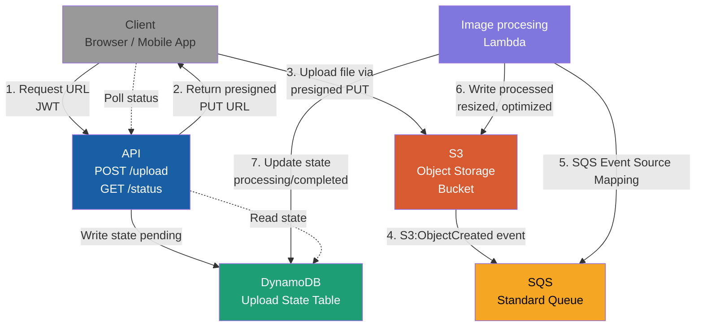
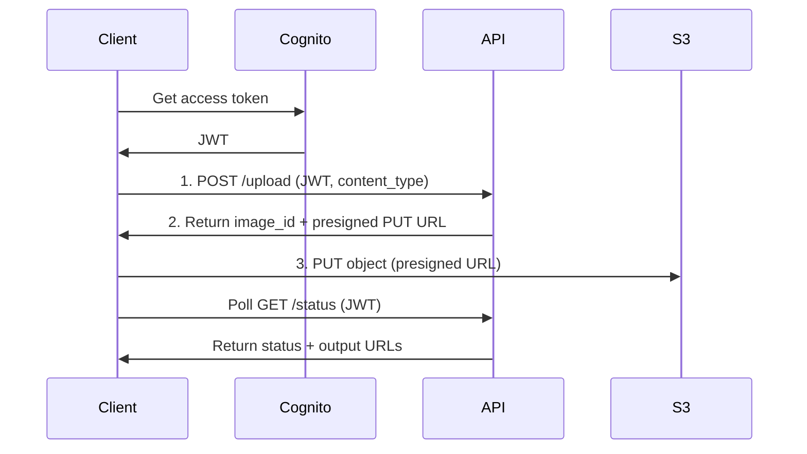

# Image Processor - Design

## Table of Contents

<!--TOC-->

- [Objective](#objective)
- [Non-goals](#non-goals)
- [Architecture — Tech Stack](#architecture--tech-stack)
- [Code Layout](#code-layout)
- [Architecture Diagram](#architecture-diagram)
- [Authentication](#authentication)
- [API Definition](#api-definition)
- [Upload Constraints](#upload-constraints)
- [User Flow](#user-flow)
- [Worker Flow](#worker-flow)
- [Error Handling & Retry Strategy](#error-handling--retry-strategy)
- [Persistence & State Transitions](#persistence--state-transitions)
- [S3 Key Convention](#s3-key-convention)
- [Image Resizing Strategy](#image-resizing-strategy)
  - [Edge cases](#edge-cases)
- [Serving processed images](#serving-processed-images)
- [Non-Functional Requirements](#non-functional-requirements)

<!--TOC-->

## Objective

Build a service for uploading and serving optimized images for web applications handling resizing and format conversion automatically.

## Non-goals

Support for anything other than images. This is not a media processor.

## Architecture — Tech Stack

- CDK
- Github Actions
- Python 3.14, uv
- API Gateway HTTP API, Amazon Cognito (JWT auth)
- AWS Lambda Powertools, Pydantic, Pillow

## Code Layout

Each Lambda is its own uv workspace member, so each ships only its own
dependencies (Pillow never lands in the API's bundle):

| Member | Purpose | Dependencies |
|---|---|---|
| `handlers/api` | One Lambda behind the HTTP API. A Powertools `APIGatewayHttpResolver` with a `Router` per area (`uploads`, `status`), combined via `include_router`. `enable_validation=True` validates requests and serializes responses from Pydantic models | Powertools, Pydantic, `common` |
| `handlers/processor` | SQS consumer that resizes images, using Powertools' `BatchProcessor` | Powertools, Pillow, `common` |
| `libs/common` | Shared library, not a Lambda: the Pydantic model for the DDB status record, the status enum, and the conditional status update | Pydantic |

The status record is written by the API (`pending`) and updated by the
processor (`processing`, `complete`, `failed`). Its model and the rule that
status never moves backwards live in `common`, so the two Lambdas can't drift.

## Architecture Diagram



## Authentication

This is an upload service for my own applications, not the public. Every API
route requires a JWT issued by **Amazon Cognito**:

- **Authorizer:** an HTTP API JWT authorizer on all routes, with issuer
  `https://cognito-idp.<region>.amazonaws.com/<user-pool-id>` and audience set
  to the allowed Cognito app client IDs. For Cognito access tokens, API Gateway
  matches the audience against the `client_id` claim.
- **One app client per application:** each consuming application gets its own
  Cognito app client. Backend applications use the OAuth 2.0
  **client credentials** grant. A browser application with signed-in users
  would use authorization code + PKCE instead.
- **Scopes:** a Cognito resource server defines `image-processor/upload` (for
  `POST /upload`) and `image-processor/read` (for `GET /status`), enforced as
  route authorization scopes.
- **Per-application identity:** the token's `client_id` is stored on the status
  record, so it's known which application uploaded each image.
  - **Isolation:** `GET /status/{image_id}` returns a record only to the client
    that created it. For any other client it returns **404**, the same as for a
    missing ID, rather than 403, so one application can't discover which image
    IDs exist.
  - **Logging:** both Lambdas add `client_id` to every log line
    (`logger.append_keys(client_id=...)`), so logs can be filtered per
    application. The processor reads it from the status record, since S3
    events don't carry it.
- **S3 keys stay application-agnostic:** images from all applications share
  `uploads/{guid}` and `processed/{guid}/...`. Ownership lives in DynamoDB
  only, which keeps `client_id` out of public CloudFront URLs.

Open question: create the user pool in the infra stack (it's stateful), or use
an existing pool shared with the applications.

## API Definition

`POST /upload`

Request:

```json
{
    "content_type": "image/png",
    "size": 2481337
}
```

- `content_type` (required): one of `image/jpeg`, `image/png`, `image/webp`,
  `image/heic`.
- `size` (optional): the file size in bytes. If given and over the upload limit,
  the API rejects the request (422) before the client starts uploading.

Both are validated by the request's Pydantic model.

Response:

```json
{
    "image_id": "server side generated guid",
    "upload_url": "presigned PUT url for uploads/<image_id>"
}
```

The client then uploads the raw file with `PUT <upload_url>`, sending a
`Content-Type` header equal to the requested `content_type`. S3 returns
`200 OK` on success.

`GET /status/{image_id}`

Response:

```json
{
    "status": "pending|processing|complete|failed",
    "images": {
        "thumb": "https://thumbnail-uri",
        "full": "https://full-uri"
    }
}
```

## Upload Constraints

Uploads use an S3 **presigned PUT** URL. Only my own applications, holding a
valid Cognito JWT, can request one, so the API's authorizer controls who can
upload. Size is enforced after upload, in the processor, rather than by S3 at
upload time.

- **Signed into the URL:** the exact key `uploads/{image_id}` and the
  `Content-Type`. S3 rejects a PUT with a different type (signature mismatch).
  The type is still client-declared, so the processor checks the file's actual
  format.
- **Expiry:** short-lived (5–15 minutes).
- **Upload limit:** proposed **20 MB**, to confirm. A presigned PUT can't
  enforce it, so:
  - the API rejects requests whose declared `size` is over the limit;
  - the processor checks `detail.object.size` from the S3 event **before
    downloading**, and marks anything over the limit as a permanent `failed`.
    An oversized upload costs bandwidth and an event, but never Lambda memory
    or time.
- **Lifecycle:** objects under `uploads/` expire after a few days, once
  `processed/` holds the outputs, so even an oversized file that slips through
  stops costing storage.
- **Event routing:** presigned PUT uploads have event reason `PutObject`, which
  the EventBridge rule already matches.
- **CORS:** if a browser performs the upload, the bucket needs a CORS rule
  allowing `PUT` from that application's origin.
- **IAM:** the API Lambda signs the URL with its own credentials, so its role
  needs `s3:PutObject` on `uploads/*` only.

If an application ever lets its own end users upload directly (an untrusted
browser), switch to presigned POST, whose signed policy can enforce
`content-length-range` at upload time.

## User Flow

- Authenticate with Cognito to get an access token
- Request an upload (`POST /upload`) and receive a presigned PUT URL
- Upload the file with `PUT` to that URL
- Poll the status endpoint
- On complete, the response includes URLs for the thumb and large image



## Worker Flow

- S3 Object Created events (`PutObject`) routed via EventBridge to an SQS queue
- Lambda event source for the queue
- Checks the object size from the event, then loads and resizes images

## Error Handling & Retry Strategy

SQS only redelivers a message when the Lambda reports it as failed. A message
the handler returns successfully for is deleted, even if the image itself
failed. So the processor splits errors in two:

| Error | Examples | Handling | Outcome |
|---|---|---|---|
| **Permanent** | Unsupported format, corrupt file, too large | Set status to `failed` in DDB, return success | Message deleted; client sees `failed` when polling |
| **Transient** | Throttling, timeouts, S3/DDB errors | Report as a batch item failure | Redelivered after the visibility timeout |

- **Partial batch failures:** the SQS event source uses
  `report_batch_item_failures`, with Powertools' `BatchProcessor`, so only the
  failed messages in a batch are retried, not the whole batch.
- **Dead-letter queue:** after 3 receives (`maxReceiveCount`), a message moves to
  the DLQ, which keeps messages for 14 days for investigation and redrive. A
  message in the DLQ therefore means a transient error that never cleared.
  Permanent errors never reach it.
- **Visibility timeout:** at least 6× the processor Lambda's timeout (AWS
  guidance for SQS event sources), so a message isn't redelivered while still
  being processed.
- **Idempotency:** standard SQS delivers at least once, so the processor must
  tolerate duplicates. Outputs go to deterministic keys
  (`processed/{guid}/...`), so reprocessing overwrites them, and status updates
  must not move a record backwards (e.g. `complete` → `processing`).

## Persistence & State Transitions

- User requests an upload URL
- Record written to DDB recording the generated guid, pending status, and the
  uploading application's Cognito `client_id`
- Processor lambda gets S3 put events via SQS, it sets processing
- When done, it sets complete
- Update logic needs to support going right from pending to complete even if that won't happen in this implementation
- Status never moves backwards. Updates are conditional writes, implemented
  once in the `common` member and used by both Lambdas
- TTL on records

## S3 Key Convention

`uploads/{guid}` - original image
`processed/{guid}/thumb.webp`
`processed/{guid}/display.webp`

Objects under `uploads/` expire via a lifecycle rule a few days after upload;
`processed/` objects are kept.

## Image Resizing Strategy

- Fixed width for thumbs and display
- 80% original quality
- WebP

Choosing fixed with so that if displayed in a row, or grid, the images will be aligned horizontally.

### Edge cases

If an image is smaller than the default min width, it will be left unchanged.

Oversized images are rejected at two levels:

- **Bytes:** the processor checks the object size from the S3 event before
  downloading, and marks anything over the upload limit as `failed` (see
  [Upload Constraints](#upload-constraints)).
- **Pixels:** a small file can decompress into a huge image (a decompression
  bomb), so the processor also checks dimensions, through Pillow's
  `MAX_IMAGE_PIXELS` guard, and treats an oversized image as a permanent error
  (`failed`).

## Serving processed images

Cloudfront

## Non-Functional Requirements

- Alarms to flag errors:
  - DLQ `ApproximateNumberOfMessagesVisible` > 0: a transient failure exhausted
    its retries
  - Upload queue `ApproximateAgeOfOldestMessage` above a threshold: the
    processor is falling behind or not consuming
  - DDB records stuck in `pending`/`processing` past an expected time
